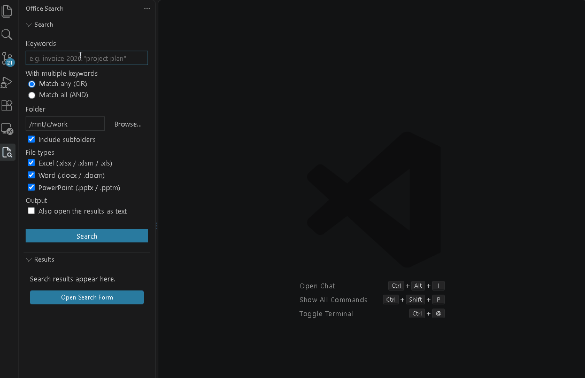

# Office Content Search

[日本語](README.ja.md)

Search text inside Word, Excel and PowerPoint files in a folder — and see exactly **where** it appears.

## Features

- **Pinpoint locations** — Results show where each match is: `Sheet1 › B12`, `Body ¶24`, `First Page Header`, `Slide 3 › Notes`, `Chart "Sales" › Series Name`.
- **No Microsoft Office required** — Files are read directly, so searching is fast and works without Office installed.
- **Multiple keywords** — Separate keywords with spaces, use `"double quotes"` for phrases, and choose **Match any (OR)** or **Match all (AND)**.
- **Forgiving matching** — Case-insensitive and full-width/half-width-insensitive (`ＡＢＣ` matches `abc`).
- **Search form in the sidebar** — Enter keywords, choose a folder, and include subfolders in one place. You can cancel a running search.
- **Highlighted results** — Matches are highlighted in the results tree. Click a result to open the file in its default application.
- **Copy file names and paths** — From the context menu, or with `Ctrl+C` / `Ctrl+Alt+C` in the results view.
- **Results as text** — Open the list of results in an editor tab to read, save or share.
- **Local only** — All processing happens on your machine. Nothing is sent anywhere.
- **English and Japanese UI**

## What Is Searched

| Format | Searched content |
| --- | --- |
| Word (`.docx`) | Body paragraphs and tables, text boxes, headers and footers, footnotes, endnotes, comments, charts, SmartArt |
| Excel (`.xlsx`) | Cell values, shapes and text boxes, charts (titles, axis titles, series names), chart sheets, SmartArt |
| Excel (`.xls`) | Cell values only |
| PowerPoint (`.pptx`) | Slide text and tables, speaker notes, charts, SmartArt |

## Usage

1. Click the **Office Search** icon in the Activity Bar.
2. Enter keywords.
3. Choose **Match any (OR)** or **Match all (AND)**. AND means the *file* contains every keyword (not necessarily in the same cell or paragraph).
4. Enter a folder or click **Browse...**, and select **Include subfolders** if needed.
5. Optionally select **Also open the results as text**.
6. Click **Search**.

You can also right-click a folder in the Explorer and select **Search Office Files in This Folder**.

Files that could not be searched are listed under **Skipped** with the reason.

## Settings

| Setting | Default | Description |
| --- | --- | --- |
| `officeSearch.includeSubfolders` | `true` | Include subfolders by default |
| `officeSearch.excludeFolders` | `[".git", "node_modules"]` | Folder names to skip when searching subfolders |
| `officeSearch.maxFileSizeMB` | `50` | Files larger than this are skipped |
| `officeSearch.maxHitsPerFile` | `200` | Maximum hits listed per file |

## Limitations

- Legacy formats (`.doc`, `.ppt`) are not supported and are listed as skipped.
- Password-protected or encrypted files (including files protected by sensitivity labels) are skipped.
- Word text is matched per paragraph. A phrase that spans two paragraphs is not found.
- Text deleted with Track Changes is not searched.
- In remote environments (WSL, SSH, Dev Containers), opening a result may depend on your environment.

## Requirements

VS Code 1.85 or later.

## Contributing

Bug reports and feature requests are welcome on [GitHub Issues](https://github.com/yoshihicode/office-content-search/issues).

## License

[MIT](LICENSE)

---

This extension is not affiliated with or endorsed by Microsoft. Microsoft, Word, Excel and PowerPoint are trademarks of the Microsoft group of companies.